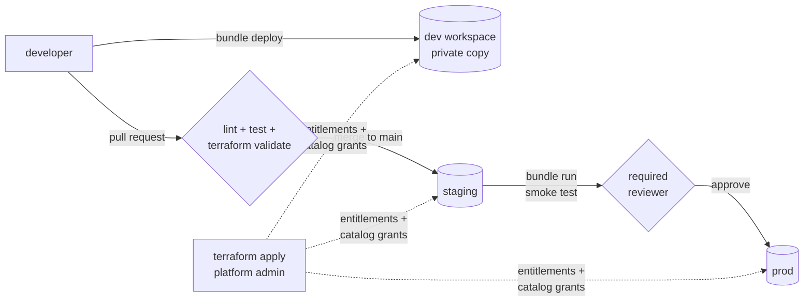

# databricks_asset_bundle

[](https://github.com/DorukMaltepe/databricks_asset_bundle/actions/workflows/ci-cd.yml)
[](LICENSE)

**A Databricks platform you can fork.** This template takes a PySpark job from a pull request
to production: it is unit tested locally, deployed to staging and run there, and promoted to
prod after a reviewer approves. Terraform controls who can touch what.

```bash
uv run pytest                        # logic tested locally, no cluster
databricks bundle deploy             # your own private copy in dev
git push                             # CI: test → staging → (approve) → prod
```

## Why

Most Databricks projects start as notebooks that someone edits directly in prod. That works
until two people change the same job, or a change breaks something nobody tested. This
template sets up the boring parts on day one:

- **Everything in git.** Jobs, schedules and permissions are YAML, reviewed like code
- **The same commit runs in every environment.** Staging and prod differ only in a few
  variables, so they can't drift apart
- **Tests that run in seconds.** Transformations are pure DataFrame functions, tested on a
  local `SparkSession`
- **A real promotion gate.** Prod is only deployed after the job has actually run in staging
  and a person has approved it
- **Least privilege.** CI deploys as a service principal. People read prod, they don't write
  to it

## What's inside

| Path | What it does |
|---|---|
| [`databricks.yml`](databricks.yml) | Bundle definition and the `dev` / `staging` / `prod` targets |
| [`resources/`](resources/) | The example job: serverless, runs the wheel daily |
| [`src/dab_starter/`](src/dab_starter/) | `transforms.py` (pure logic) and `main.py` (table I/O) |
| [`tests/`](tests/) | pytest with a local `SparkSession` |
| [`terraform/`](terraform/) | Workspace entitlements and Unity Catalog grants per environment |
| [`.github/workflows/ci-cd.yml`](.github/workflows/ci-cd.yml) | Lint, test, deploy and promote |
| [`docs/WHY.md`](docs/WHY.md) | The reasoning behind each choice |

The example job reads `samples.tpch.orders` (in every workspace), removes rows that have no
key or a duplicate key, and writes `<catalog>.<schema>.daily_revenue`.

## Quickstart

1. **Use this template** on GitHub, then replace the `<...-workspace-host>` placeholders in
   `databricks.yml` and `terraform/envs/*.tfvars`, and add your deployer service principal's
   application ID.
2. **Grant permissions** once per workspace. A platform admin does this, not CI:
   ```bash
   cd terraform
   terraform init
   terraform apply -var-file=envs/prod.tfvars
   ```
3. **Configure GitHub**: create the environments `staging` and `prod`. Add
   `DATABRICKS_CLIENT_ID` and `DATABRICKS_CLIENT_SECRET` (an OAuth secret for the service
   principal) to each one. Turn on **Required reviewers** for `prod`.
4. **Deploy your own dev copy**:
   ```bash
   databricks auth login --host https://<dev-workspace-host>
   databricks bundle deploy
   databricks bundle run daily_revenue
   ```

## Promotion flow

| Event | What happens |
|---|---|
| Pull request | ruff, pytest, `terraform fmt` and `validate` |
| Merge to `main` | all of the above → deploy to **staging** → run the job as a smoke test |
| Approval in GitHub | the same commit is deployed to **prod** |

## Architecture



## Design decisions

- **Bundles deploy jobs, Terraform manages permissions.** They change at different rates and
  need different credentials, so the deploy identity never has admin rights.
- **Promotion means approving a run, not merging to another branch.** There's one branch and
  one commit, which removes release merges and any doubt about what prod is running.
- **Logic is kept separate from I/O.** Only `main.py` touches tables. Everything else can be
  tested without a workspace.
- **Serverless by default.** There are no cluster sizes or runtime versions to keep in sync
  across environments.
- **`databricks_grants` is authoritative.** Grants someone adds by hand in the UI are removed
  on the next apply instead of piling up.

The longer version is in [docs/WHY.md](docs/WHY.md).

## Development

You need [uv](https://docs.astral.sh/uv/) and Java 17 (for local Spark).

```bash
uv run pytest
uvx ruff check . && uvx ruff format --check .
```

## Roadmap

- [ ] Lakeflow Declarative Pipelines (DLT) example alongside the job
- [ ] Integration tests against a real workspace, run on staging
- [ ] Data quality checks that block promotion
- [ ] Remote Terraform state per environment (S3 / Azure Storage / GCS)
- [ ] Pin `databricks/setup-cli` to a release

## License

MIT
